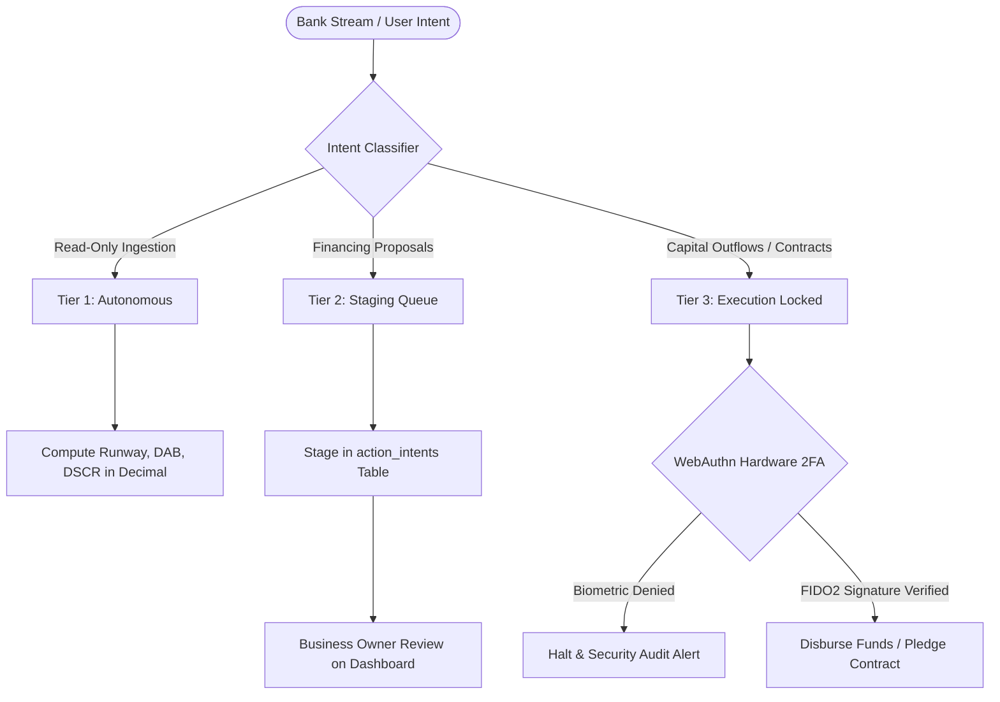

# SME Finance Copilot

> **Autonomous AI CFO & Financial Participant for Small & Medium Enterprises**  
> *FinTechathon 2026 Topic E: AI as a Financial Participant (Tsinghua University PBCSF & WeBank)*

[](https://www.python.org/)
[](https://fastapi.tiangolo.com/)
[](https://nextjs.org/)
[](https://web.dev/progressive-web-apps/)
[](https://soliditylang.org/)
[](https://fisco-bcos.org/)
[](LICENSE)

**Project Form Factor**: Responsive Web Service + Progressive Web App (PWA) with native in-browser WebAuthn (TouchID/FaceID) hardware verification.

---

### Master Documentation Suite

Every specification, design decision, and operational guideline is documented and interconnected:

- 📘 [System Design Specification](docs/system.md) — Implementation mechanics, mathematical formulations, schemas & smart contracts
- 🏛️ [Architectural Plan & Roadmap](docs/architecture.md) — 6-layer topology, 1-Supervisor + 4-Squads model & multi-agent orchestration
- 🛡️ [Security Architecture & Defense-in-Depth](docs/security.md) — 5 Invariants, threat defense, self-healing & decadal resilience
- 👥 [Team Distribution & Parallel Track Guide](docs/team_distribution_guide.md) — 4-track isolated roles, autonomous prompts & branch protocols
- ⚡ [Sprint Execution Workflow](.agent/workflows/sprint-workflow.md) — 5-gate development lifecycle & parallel track operating model
- 📜 [Architecture Decision Records (ADRs)](docs/adr/) — 7 formal architecture decision records (ADR-001 to ADR-007)

---

## 1. Executive Summary & Problem Statement

Small and Medium Enterprises (SMEs) represent over 90% of global businesses and 50% of employment. However, **82% of SME closures stem from cash flow mismanagement and working capital timing mismatches**, rather than a lack of underlying profitability.

```
       [Raw Materials Purchased]         [Finished Goods Sold]             [Cash Collected]
  Day 0 -------------------------- Day 45 ----------------------- Day 105 -----------------
        |                                |                        |
        +-- Supplier Paid: Day 30        |                        |
            (-$30,000 cash out)          |                        |
                                         +-- Invoiced: Day 45     |
                                             ($100,000 Net 60)    |
                                                                  +-- Customer Pays: Day 105
                                                                      (+$100,000 cash in)

  ==> THE 75-DAY CASH GAP: Cash Conversion Cycle (CCC) = DIO (45) + DSO (60) - DPO (30) = 75 Days
```

Traditional commercial banks require 4 to 8 weeks to underwrite working capital loans and reject up to 80% of applicants due to a lack of physical real estate collateral.

**SME Finance Copilot** acts as a 24/7 autonomous financial participant. It monitors real-time transactional ledger streams, computes deterministic financial ratios, forecasts cash crunches before payroll bounces, matches businesses with pre-qualified working capital facilities, and registers B2B invoice pledges on consortium blockchains to prevent double-financing.

---

## 2. Core Capabilities & Product Features

```
┌─────────────────────────────────────────────────────────────────────────────────────────┐
│                                SME FINANCE COPILOT                                      │
├────────────────────────────┬────────────────────────────┬───────────────────────────────┤
│    1. CFO Health Core      │  2. Conformal Forecaster   │    3. Digital Underwriting    │
│  • Pure Decimal runway     │  • MAPIE P10/P50/P90 bands │  • WeBank Weiyidai linkage    │
│  • Daily Average Balance   │  • 30/60/90-day horizons   │  • PuLP MILP cost minimizer   │
│  • DSCR & Burn calculation │  • Kaplan-Meier DSO hazard │  • Predatory APR flag (>36%)  │
├────────────────────────────┼────────────────────────────┼───────────────────────────────┤
│   4. Three-Tier Gate       │   5. Privacy Shield        │   6. Consortium Blockchain    │
│  • Tier 1: Read-only auto  │  • Microsoft Presidio PII  │  • FISCO BCOS smart contract  │
│  • Tier 2: Proposal staging│  • IBAN & Phone redaction  │  • Canonical SHA-256 hashing  │
│  • Tier 3: WebAuthn 2FA    │  • PostgreSQL RLS isolation│  • Double-pledge prevention   │
└────────────────────────────┴────────────────────────────┴───────────────────────────────┘
```

### 2.1 Deterministic CFO Financial Health Diagnostics
- Computes exact Net Daily Burn, Cash Runway, Daily Average Balance (DAB), and Debt Service Coverage Ratio (DSCR).
- Enforces pure Python `decimal.Decimal` with `ROUND_HALF_UP` arithmetic. Prohibits mental arithmetic and LLM mathematical approximations.

### 2.2 Predictive Cash Crunch Forecasting (MAPIE Conformal Prediction)
- Generates non-parametric prediction intervals across 30, 60, and 90-day forward horizons.
- Outputs pessimistic ($P_{10}$), median ($P_{50}$), and optimistic ($P_{90}$) cash corridors at 90% empirical coverage, alerting business owners before deficits occur.
- Uses Kaplan-Meier survival curves to estimate customer invoice settlement delays (DSO).

### 2.3 Intelligent Digital Underwriting & Financing Matcher
- Replaces static annual tax returns with high-frequency transactional data streams (inspired by WeBank's *Weiyidai* credit assessment model).
- Evaluates Revenue-Based Financing, Invoice Factoring, and Working Capital Lines.
- Runs a PuLP Mixed-Integer Linear Program (MILP) to minimize financing costs.
- Enforces Truth-in-Lending rules: converts factor rates into true APR and flags any facility exceeding 36% APR as predatory.

### 2.4 Consortium Blockchain Invoice Double-Pledge Prevention
- Generates canonical `SHA-256` content hashes from invoice metadata:
  $$\text{InvoiceHash} = \text{SHA-256}(\text{TaxID} \parallel \text{BuyerID} \parallel \text{InvoiceNum} \parallel \text{AmountCents})$$
- Submits verification payloads to `InvoiceRegistry.sol` on FISCO BCOS to prevent fraudulent invoice double-financing across multiple lenders.

---

## 3. Provable Reliability, Security & Trust

Autonomous financial participants require mathematical guarantees, not heuristic promises. SME Finance Copilot enforces five standing security invariants:



| Security Dimension | Implementation Mechanism | Business & Audit Guarantee |
|---|---|---|
| **0% LLM Math** | Isolated calculation engine in `services/calculations/` | Eliminates hallucinations in interest calculations, runway estimates, and debt service ratios. |
| **Three-Tier Gate** | Pydantic v2 schemas with `extra="forbid"` in `services/security/` | Prohibits unauthorized money movements. System stages intents; capital transfers require physical confirmation. |
| **WebAuthn Biometrics** | FIDO2 challenge verification bound to browser cryptographic keys | Requires TouchID, FaceID, or hardware security keys for live fund disbursement or loan execution. |
| **Privacy Shield** | Automated PII scrubbing in `services/ingestion/` | Redacts IBANs, bank account numbers, and phone numbers before data enters storage or LLM context. |
| **Tenant Isolation** | PostgreSQL Row-Level Security (RLS) on `tenant_id` | Enforces database-level multi-tenant boundaries; prevents cross-tenant data leakage or IDOR parameter tampering. |

---

## 4. System Architecture & Form Factor

### 4.1 Form Factor Decision: Responsive Web + Progressive Web App (PWA)
We selected a Responsive Web Application with Progressive Web App (PWA) packaging over native desktop or mobile binaries:
1. **Zero Download Friction**: Business owners access the dashboard from any browser immediately without app store review delays.
2. **Instant Security Patching**: Financial logic updates deploy in 0 seconds without requiring client-side binary re-installations.
3. **Native Hardware Biometrics**: Leverages standard W3C WebAuthn APIs for TouchID and FaceID hardware authentication directly in Chrome, Safari, and Edge.
4. **Minimal Attack Surface**: Eliminates binary reverse-engineering risks associated with shipped Electron or Flutter packages.

### 4.2 Macro Topology

```
┌────────────────────────────────────────────────────────────────────────┐
│ 1. DATA INGESTION: Open Banking CSV, Plaid Webhooks, VAT E-Invoices     │
├────────────────────────────────────────────────────────────────────────┤
│ 2. PRIVACY SHIELD: Microsoft Presidio PII Masking (IBANs, Phones)      │
├────────────────────────────────────────────────────────────────────────┤
│ 3. DETERMINISTIC CORE: Python decimal.Decimal (Runway, DAB, DSCR)       │
├────────────────────────────────────────────────────────────────────────┤
│ 4. RISK & FORECASTING: MAPIE Conformal Corridor + Kaplan-Meier DSO      │
├────────────────────────────────────────────────────────────────────────┤
│ 5. SECURITY GATE: 3-Tier Permission Matrix + WebAuthn FIDO2 Verifier    │
├────────────────────────────────────────────────────────────────────────┤
│ 6. CONSORTIUM ANCHOR: FISCO BCOS InvoiceRegistry.sol (PBFT Consensus)   │
├────────────────────────────────────────────────────────────────────────┤
│ 7. PRESENTATION: Next.js 14 Executive Dashboard (tabular-nums, PWA)    │
└────────────────────────────────────────────────────────────────────────┘
```

---

## 5. Hackathon Rubric Alignment

| Evaluation Criteria | Weight | How SME Finance Copilot Delivers |
|---|---|---|
| **Task Completion** | **40%** | Ingests bank transaction streams, computes exact financial ratios, forecasts cash deficits 30-90 days in advance, and constructs pre-qualified working capital proposals. |
| **Defensive Security & Compliance** | **30%** | Three-Tier Security Gate isolating read-only analytics from capital movement, WebAuthn physical biometric 2FA, Presidio PII redaction, and Truth-in-Lending APR disclosures. |
| **Technical Innovation** | **30%** | WeBank-inspired continuous cash flow underwriting, MAPIE distribution-free conformal forecasting, and consortium blockchain invoice pledge anchoring. |

---

## 6. Quickstart & Verification (30-Second Setup)

### Prerequisites
- Python 3.11+
- Node.js 18+ (for frontend dashboard)

### Step 1: Clone Repository
```powershell
git clone https://github.com/SamJU25/F-SME-Finance-Copilot.git
cd F-SME-Finance-Copilot
```

### Step 2: Install Python Dependencies
```powershell
pip install -r requirements.txt
```

### Step 3: Run Deterministic Verification Suites
Execute the unit calculations and security invariant tests:
```powershell
pytest
```
*Current Verification Baseline*: **11 passed in 0.48s** (7 financial calculation assertions + 4 security invariant assertions).

### Step 4: Verify Knowledge Graph & Architecture AST
```powershell
cmd /c "python -m graphify update ."
```
*Graph Baseline*: **1,797 nodes, 1,815 edges across 213 communities**.

---

## 7. Parallel Team Collaboration Model

To enable 4 developers with different specialties to collaborate concurrently without git merge conflicts, the codebase is partitioned into **4 disjoint track directories**:

```
                                 ┌──> feat/agent-security-core (Track A - Lead) ────────┐
                                 ├──> feat/frontend-dashboard  (Track B - Frontend) ────┼──> main
git checkout -b <track-branch> ──┼──> feat/fintech-engine      (Track C - Calculations) ┤   (Production)
                                 └──> feat/blockchain-qa       (Track D - Security/BCOS)┘
```

- **Track A (Team Lead)**: `services/security/`, `services/llm/`, `api/`
- **Track B (Frontend Specialist)**: `frontend/` (Next.js 14 App Router, Recharts, PWA)
- **Track C (Quantitative Engineer)**: `services/calculations/`, `services/risk/`, `services/matcher/`
- **Track D (Blockchain & QA Engineer)**: `services/ingestion/`, `contracts/`, `tests/security/`

Complete role instructions and autonomous agent kickoff directives are documented in [`docs/team_distribution_guide.md`](docs/team_distribution_guide.md).

---

## 8. License & Competition Notice

This project is developed for **FinTechathon 2026 Topic E: AI as a Financial Participant**, organized by Tsinghua University PBCSF and WeBank.

Distributed under the MIT License. See [`LICENSE`](LICENSE) for details.
