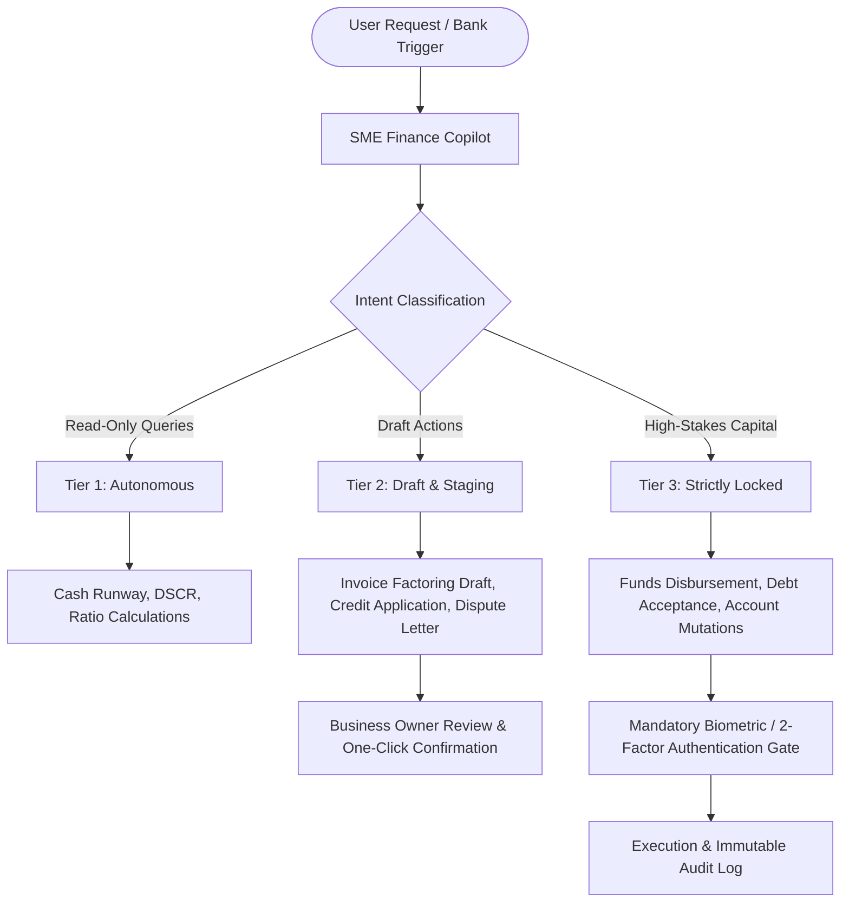

# SME Finance Copilot

> **Autonomous AI CFO & Financial Participant for Small & Medium Enterprises (SMEs)**

[](https://www.python.org/)
[](https://fastapi.tiangolo.com/)
[](https://nextjs.org/)
[](https://opensource.org/licenses/MIT)

---

## 1. Executive Summary & Problem Statement

Small and Medium Enterprises (SMEs) represent over 90% of global businesses and 50% of employment. However, **82% of SME failures are caused by cash flow mismanagement and working capital timing mismatches**, not a lack of profitability.

```
       [Raw Materials Purchased]         [Finished Goods Sold]             [Cash Collected]
  Day 0 -------------------------- Day 45 ----------------------- Day 105 -----------------
        |                                |                        |
        +-- Supplier Paid: Day 30        |                        |
            (-$30,000 cash out)          |                        |
                                         +-- Invoiced: Day 45     |
                                             ($100,000 Net 60)    |
                                                                  +-- Customer Pays: Day 105
                                                                      (+$100,000 cash in)

  ==> THE 75-DAY CASH GAP: Cash Conversion Cycle (CCC) = DIO (45) + DSO (60) - DPO (30) = 75 Days
```

Traditional banks take 4 to 8 weeks to underwrite SME loans and reject up to 80% of applicants due to a lack of physical real estate collateral. **SME Finance Copilot** bridges this structural funding gap by providing 24/7 autonomous cash flow intelligence, proactive cash crunch forecasting, and real-time digital underwriting.

---

## 2. Core Architecture & Hackathon Rubric Alignment

| Evaluation Criteria | Weight | How SME Finance Copilot Delivers |
|---|---|---|
| **Task Completion** | **40%** | Ingests real-time bank streams, computes exact mathematical ratios (Cash Runway, Burn Rate, DSCR, CCC), and drafts financing solutions before payroll bounces. |
| **Defensive Security & Compliance** | **30%** | Strict **Three-Tier Permission Gate** isolating read-only analytics from high-stakes financial operations, backed by automated KYC/AML audit logs and prompt injection defenses. |
| **Technical Innovation** | **30%** | Replaces static paperwork with continuous cash-flow scoring (inspired by WeBank's *Weiyidai* digital lending model) and consortium blockchain verification to prevent invoice double-financing. |

---

## 3. The Three-Tier Security Gate

Financial participants must guarantee zero unsupervised capital movement. All operations are strictly categorized:



* **Tier 1 (Read-Only Autonomous)**: Calculating cash runway, analyzing daily average balance, monitoring debt service coverage. Runs with zero human friction.
* **Tier 2 (Action Drafting)**: Staging invoice factoring requests, preparing credit line applications, drafting supplier payment plans. The Copilot drafts; the business owner approves.
* **Tier 3 (High-Stakes Execution)**: Live fund disbursement, accepting credit lines, changing banking rails. Strictly locked behind mandatory Human 2FA.

---

## 4. Quick Start & Installation

### Step 1: Clone Repository
```bash
git clone https://github.com/SamJU25/F-SME-Finance-Copilot.git
cd F-SME-Finance-Copilot
```

### Step 2: Install Python Dependencies
```bash
pip install -r requirements.txt
```

### Step 3: Verify Test Suite & Knowledge Graph
```bash
# Run deterministic test suite
pytest

# Verify AST architecture knowledge graph
python -m graphify update .
```

---

## 5. Development & Assistant Compatibility

The repository includes native configuration for modern AI-assisted engineering environments:

* **Google Antigravity**: Automatically loads project rules and execution skills via [`GEMINI.md`](file:///F:/SME%20Finance%20Copilot/GEMINI.md) and [`.agent/`](file:///F:/SME%20Finance%20Copilot/.agent).
* **Claude / Claude Code**: Full operational parity enforced via [`CLAUDE.md`](file:///F:/SME%20Finance%20Copilot/CLAUDE.md).
* **Deterministic Separation**: All mathematical operations (CCC, DSCR, factor rate to APR conversion) are executed via Python code; LLMs are restricted from mental arithmetic.

---

## 6. Repository Documentation Index

* [`AGENTS.md`](file:///F:/SME%20Finance%20Copilot/AGENTS.md) — Comprehensive catalog of 57 specialized subagents across 8 squads and Scenario Routing Matrix.
* [`GEMINI.md`](file:///F:/SME%20Finance%20Copilot/GEMINI.md) — Standing engineering invariants, SDLC gates, and 7 end-to-end domain workflows.
* [`CLAUDE.md`](file:///F:/SME%20Finance%20Copilot/CLAUDE.md) — Operational parity and invariant enforcement protocol for Claude Code.
* [`GLOSSARY.md`](file:///F:/SME%20Finance%20Copilot/GLOSSARY.md) — Ubiquitous financial terminology dictionary (Cash Conversion Cycle, DSCR, WeBank Weiyidai, FISCO BCOS).
* [`graphify-out/wiki/index.md`](file:///F:/SME%20Finance%20Copilot/graphify-out/wiki/index.md) — Persistent 182-article AST architecture knowledge graph and wiki.

---

## 7. License

Distributed under the MIT License. See `LICENSE` for more information.
