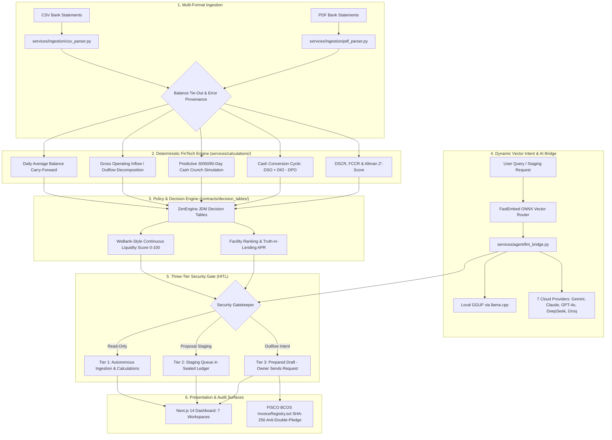

# CashPilot

> **Autonomous AI Financial Participant & Treasury Copilot for Small & Medium Enterprises**  
> *FinTechathon 2026 Topic E: AI as a Financial Participant | Tsinghua University PBCSF & WeBank*

[](https://github.com/SamJU25/CashPilot/actions/workflows/ci.yml)
[](tests/)
[](https://www.python.org/)
[](https://fastapi.tiangolo.com/)
[](https://nextjs.org/)
[](docker-compose.yml)
[](contracts/)
[](LICENSE)

**Audited Technical Baseline (2026-10-20)**: **974 automated tests passing (1 POSIX-only skip)** across multi-format statement ingestion (CSV and PDF), 25+ deterministic financial calculation routines in pure Python `decimal.Decimal`, dynamic semantic intent routing (FastEmbed ONNX), on-device local GGUF inference (Qwen 2.5 / Llama 3.2 text models via llama.cpp), Universal Cloud LLM Bridge with live dynamic model discovery across 7 providers, Three-Tier Security Gate with owner-sent Tier 3 requests (no execution route), and a Next.js 14 executive dashboard with 7 functional workspaces.

---

## Documentation Hub

Read [`AGENTS.md`](AGENTS.md) for instruction precedence and verified baseline status, [`docs/system.md`](docs/system.md) for concrete mathematical and technical specifications, and [`docs/architecture.md`](docs/architecture.md) for system topology.

| Document | Purpose & Scope |
|---|---|
| 📘 [System Design Specification](docs/system.md) | Concrete implementation mechanics, mathematical formulas, JSON schemas & smart contracts |
| 🏛️ [Architectural Plan & Roadmap](docs/architecture.md) | 6-layer topology, local SLM inference, dynamic vector routing & multi-agent suites |
| 🛡️ [Security Architecture](docs/security.md) | 5 Invariants, threat modeling, Three-Tier Gate (owner-sent Tier 3) & cryptographic defense |
| 📖 [Ubiquitous Domain Glossary](docs/GLOSSARY.md) | Standardized fintech, underwriting, and treasury terminology (CCC, DAB, DSCR, APR) |
| ⚡ [Sprint Workflow](.agent/workflows/sprint-workflow.md) | Contract-first engineering lifecycle and red-green-refactor loop |

---

## 1. Problem Statement: The 75-Day Working Capital Gap

Small and Medium Enterprises (SMEs) represent over 90% of global businesses and 50% of employment. However, **82% of SME bankruptcies stem from cash flow timing mismatches**, rather than a lack of underlying profitability.

Traditional banks require 4 to 8 weeks to underwrite working capital loans and reject up to 80% of applicants due to lack of physical real estate collateral.

```
       [Raw Materials Purchased]         [Finished Goods Sold]             [Cash Collected]
  Day 0 -------------------------- Day 45 ----------------------- Day 105 -----------------
        |                                |                        |
        +-- Supplier Paid: Day 30        |                        |
            (-$30,000 cash out)          |                        |
                                         +-- Invoiced: Day 45     |
                                             ($100,000 Net 60)    |
                                                                  +-- Customer Pays: Day 105
                                                                      (+$100,000 cash in)

  ==> THE 75-DAY CASH GAP: Cash Conversion Cycle (CCC) = DIO (45) + DSO (60) - DPO (30) = 75 Days
```

**CashPilot** acts as a 24/7 autonomous financial participant. It monitors real-time transactional ledger streams, computes deterministic financial ratios, forecasts cash crunches before payroll bounces, matches businesses with pre-qualified working capital facilities, and registers B2B invoice pledges on consortium blockchains to eliminate invoice double-financing.

---

## 2. System Architecture



### 2.1 Multi-Format Statement Ingestion Engine (`services/ingestion/`)
- Parsers for UTF-8 CSV bank statements in standard formats and multi-page text-based PDF statements (`csv_parser.py`, `financial_parsers.py`, `pdf_parser.py`).
- Line-item transaction extraction with opening and closing balance mathematical tie-out:
  $$\text{Opening Balance} + \sum \text{Credits} - \sum \text{Debits} == \text{Closing Balance}$$
- Deterministic row-level error provenance tracking: `INVALID_ROW_SHAPE`, `INVALID_DATE`, `INVALID_AMOUNT`, `INVALID_CURRENCY`, `DUPLICATE_TRANSACTION_ID`, `OUT_OF_ORDER_DATE`.
- Multi-account contra-transfer elimination to prevent duplicate internal cash flow counting across accounts.

### 2.2 Deterministic FinTech Engine (25+ Core Routines in `services/calculations/`)
All monetary calculations execute in pure Python `decimal.Decimal` with `ROUND_HALF_UP` rounding. Zero mathematical calculations are performed by LLMs:
1. **Daily Average Balance (DAB)**: Rolling 30, 60, and 90-day calendar carry-forward across missing weekends and bank holidays (`calculate_dab_from_transactions`).
2. **Gross Cash Flow Decomposition**: Gross operating credits, gross operating debits, net period change, and exact cash runway days (`calculate_cash_analysis`).
3. **Predictive Cash Crunch & Overdraft Pinpointing**: Daily closing balance forward simulation pinpointing projected deficit date and shortfall cents (`predictive_cash.py`).
4. **Weekly Revenue Inflow Volatility Index (CV)**: 7-day interval mean, standard deviation, and coefficient of variation ($CV = \sigma / \mu$) mapped to risk tiers (LOW, MEDIUM, HIGH, CRITICAL).
5. **Working Capital Cash Conversion Cycle (CCC)**: Days Sales Outstanding (DSO), Days Inventory Outstanding (DIO), Days Payable Outstanding (DPO), and total CCC:
   $$\text{CCC} = \text{DSO} + \text{DIO} - \text{DPO}$$
6. **Debt Affordability Models**: Debt Service Coverage Ratio (DSCR) and Fixed-Charge Coverage Ratio (FCCR) (`credit.py`).
7. **Altman Z'-Score for Private Firms**: Bankruptcy hazard classification for non-public enterprises (`credit.py`).
8. **DuPont ROE 3-Stage Decomposition**: Net profit margin $\times$ asset turnover $\times$ equity multiplier (`profitability.py`).
9. **ROIC & Economic Value Added (EVA)**: NOPAT over invested capital and cost-of-capital excess return (`profitability.py`).
10. **Discounted Cash Flow (DCF) & WACC Valuation**: FCFF projections with perpetuity growth terminal value (`valuation.py`).
11. **SaaS Unit Economics**: ARR, CAC Payback, LTV/CAC ratio, Magic Number, and Net Revenue Retention (`unit_economics.py`).
12. **Truth-in-Lending APR & Trade Credit APR**: Factor rate to APR conversion, flagging loans $>36.0\%$ APR as predatory (`credit.py`).
13. **Currency Conversion & Multi-Currency Registry**: ISO 4217 currency registry covering 160+ currencies (`currency.py`).
14. **Continuous Liquidity Scoring (0–100)**: Multi-factor weighted score with gray-zone triage for Prime vs. Conditional facilities (`liquidity_matcher.py`).

### 2.3 Universal Dynamic AI Bridge & Local SLM (`services/agent/`)
- **Dual Inference Engine**:
  - **Local SLM Engine**: On-device text generation via quantized GGUF models (`qwen2.5-3b-instruct` default, `qwen2.5-1.5b-instruct`, `llama-3.2-3b-instruct`, `llama-3.2-1b-instruct`) powered by `llama-cpp-python` with dynamic device hardware capability matching (CPU/CUDA) and live model discovery.
  - **Universal Cloud LLM Bridge** (`llm_bridge.py`): Native support for Google Gemini 2.0 Flash, Anthropic Claude 3.5 Sonnet, OpenAI GPT-4o, DeepSeek, Groq, Local Ollama, and Custom OpenAI-compatible endpoints.
- **Dynamic Live Model Discovery**: `POST /api/v1/agent/fetch-models` queries upstream provider endpoints dynamically to retrieve real-time model catalogs.
- **Dynamic Connection Verification**: `POST /api/v1/agent/test-connection` verifies provider credentials and endpoint reachability with detailed round-trip latency metrics.
- **Dynamic Semantic Vector Routing**: FastEmbed ONNX embedding pipeline (`BAAI/bge-small-en-v1.5`) with cosine similarity triage—zero regex or hardcoded keyword intercepts.
- **Anti-Slop Post-Processing**: Dynamic neural CFO responses grounded in deterministic calculation context without template repetitions.
- **Pre-Flight Privacy Shield**: PII scrubbing redacting IBANs, bank routing numbers, and contact details before data enters LLM context.

### 2.4 Three-Tier Security Gate (`services/security/`)
Every action endpoint is scoped to a **verified tenant identity**: callers mint a signed tenant token at `POST /api/v1/auth/token` with their enrollment key, and the ledger never trusts a client-supplied `tenant_id` or `X-Tenant-ID` header.

```
+---------------------------------------------------------------------------------------------------+
| TIER 1: OBSERVATION (Autonomous)                                                                  |
| Read-only ingestion, CSV/PDF balance tie-out, 25+ Decimal financial ratios, and cash forecasts.   |
+---------------------------------------------------------------------------------------------------+
                                                  │
                                                  ▼
+---------------------------------------------------------------------------------------------------+
| TIER 2: STAGING (Queue Only — Zero Capital Movement)                                              |
| Financing proposals, factoring drafts, and reminders queued in an immutable, Fernet-sealed ledger.|
+---------------------------------------------------------------------------------------------------+
                                                  │
                                                  ▼
+---------------------------------------------------------------------------------------------------+
| TIER 3: OWNER-SENT (Never Executed by System)                                                     |
| CashPilot drafts the request at POST /api/v1/actions/{id}/prepare. The business owner reviews it  |
| and transmits it directly via their own bank/lender portal. No payment credentials in the system. |
+---------------------------------------------------------------------------------------------------+
```

- **Tier 1 (Observation — Autonomous)**: Read-only data ingestion and calculations.
- **Tier 2 (Staging — Queue Only)**: Loan applications and credit proposals placed into an immutable staging ledger (`action_intents.json`). No capital movement.
- **Tier 3 (Owner-Sent)**: Irreversible financial transactions (drawing credit lines, wire disbursements, contract signing) are never carried out by CashPilot. The owner gets a pre-filled request (`POST /api/v1/actions/{id}/prepare`) and sends it from their own email or the lender's form; with no payment credentials stored in the system, no prompt injection or exploit can move funds.

### 2.5 Consortium Blockchain Double-Pledge Defense (`contracts/`)
- Generates canonical `SHA-256` content hashes from invoice metadata:
  $$\text{InvoiceHash} = \text{SHA-256}(\text{TaxID} \parallel \text{BuyerID} \parallel \text{InvoiceNum} \parallel \text{AmountCents})$$
- Submits verification payloads to `InvoiceRegistry.sol` on FISCO BCOS consortium blockchain to eliminate fraudulent invoice double-pledging across lenders.

### 2.6 Next.js Executive Dashboard (`src/app/`)
- 7 specialized SME treasury workspaces built on Next.js 14 App Router and React 18:
  1. **Overview (`/`)**: Real-time cash runway, Daily Average Balance, working capital metrics, and interactive cash forecast charts.
  2. **Assistant (`/assistant`)**: Streaming AI CFO chat with dynamic model selection, calculation grounding, and pre-flight PII redaction.
  3. **Approvals (`/approvals`)**: Three-Tier human-in-the-loop staging ledger for reviewing and preparing drafted credit/factoring actions.
  4. **Funding (`/funding`)**: Digital underwriting marketplace ranking pre-qualified financing facilities by APR, speed, and suitability.
  5. **Receivables (`/receivables`)**: B2B invoice registry with canonical SHA-256 hashing and double-pledge status verification.
  6. **Statements (`/statements`)**: Drag-and-drop CSV and PDF bank statement ingestion with balance tie-out and row error provenance.
  7. **Settings (`/settings`)**: Tenant enrollment, provider credential management, and local SLM status monitoring.
- Monospace tabular numbers (`font-variant-numeric: tabular-nums`), responsive sidebar navigation, Emil Kowalski spring motion transitions (<280ms), and 4-state component handling (loading, empty, error with retry, populated).

---

## 3. Technology Stack & Dependencies

### 3.1 Runtime & Environment Requirements

| Runtime / Tool | Required Version | Verification Command | Purpose |
|---|---|---|---|
| **Python** | `>= 3.11.0` | `python --version` | Core backend calculation engine, FastAPI service, and security layers |
| **Node.js** | `>= 18.18.0` (LTS 20 recommended) | `node --version` | Next.js 14 frontend runtime and SSR build toolchain |
| **npm** | `>= 9.0.0` | `npm --version` | Node package management and workspace script runner |
| **Docker Engine** | `>= 24.0.0` | `docker --version` | Production rootless multi-stage container isolation |
| **Docker Compose** | `>= 2.20.0` | `docker compose version` | Multi-container orchestration (backend, frontend, persistent volumes) |

---

### 3.2 Python Backend Dependencies (`requirements.txt`)

All backend dependencies are pinned or constrained with tested minimum versions:

| Package | Version Constraint | Category | Architectural Function |
|---|---|---|---|
| [`fastapi`](https://pypi.org/project/fastapi/) | `>=0.115.0` | REST API | Asynchronous API framework, OpenAPI 3.1 schema generation, dependency injection |
| [`uvicorn[standard]`](https://pypi.org/project/uvicorn/) | `>=0.30.0` | ASGI Server | Production ASGI server with uvloop event loop and httptools parser |
| [`pydantic`](https://pypi.org/project/pydantic/) | `>=2.8.0` | Data Validation | Strict data validation, schema enforcement, Decimal string serialization |
| [`python-multipart`](https://pypi.org/project/python-multipart/) | `>=0.0.9` | Ingestion | Streaming multipart form-data parser for statement uploads (CSV/PDF) |
| [`zen-engine`](https://pypi.org/project/zen-engine/) | `>=2.1.3` | Rule Engine | Deterministic JSON Decision Model (JDM) execution for loan covenants and risk tiers |
| [`pypdf`](https://pypi.org/project/pypdf/) | `>=5.1.0` | PDF Ingestion | Multi-page bank statement text extraction, tabular line-item parsing |
| [`cryptography`](https://pypi.org/project/cryptography/) | `>=42.0.0` | Security | Fernet symmetric data sealing (`enc:v1:`) for persisted state at rest |
| [`numpy`](https://pypi.org/project/numpy/) | `>=1.26.0` | Numerical Math | Array operations and cosine similarity calculation for semantic routing |
| [`fastembed`](https://pypi.org/project/fastembed/) | `>=0.3.0` | Embeddings | Local ONNX embedding inference (`BAAI/bge-small-en-v1.5`) without GPU requirements |
| [`huggingface-hub`](https://pypi.org/project/huggingface-hub/) | `>=0.24.0` | Model Management | Local model cache inspection, SHA verification, and weight management |
| [`httpx`](https://pypi.org/project/httpx/) | `>=0.27.0` | HTTP Client | Asynchronous client for upstream LLM provider API dispatch and test harnesses |
| [`pytest`](https://pypi.org/project/pytest/) | `>=8.2.0` | Testing | Automated unit, integration, security, and e2e financial assertion framework |

#### Optional Local Machine Learning Dependencies
For running local GGUF models on-device without cloud providers:
- `llama-cpp-python>=0.2.85`: Fast C/C++ GGUF inference runtime with CUDA / Metal GPU offloading and CPU fallback
- `huggingface-hub>=0.24.0`: Single-file GGUF download with resume support and SHA verification

---

### 3.3 Frontend Dashboard Dependencies (`package.json`)

| Package | Version | Category | Architectural Function |
|---|---|---|---|
| [`next`](https://www.npmjs.com/package/next) | `^14.2.15` | Framework | React Server Components, App Router, static generation, API proxies |
| [`react`](https://www.npmjs.com/package/react) / [`react-dom`](https://www.npmjs.com/package/react-dom) | `^18.3.1` | UI Library | Concurrent React rendering, hooks, state lifecycle management |
| [`@radix-ui/*`](https://www.radix-ui.com/) | `Latest` | UI Primitives | Accessible, unstyled dialogs, dropdowns, selects, tabs, popovers, tooltips |
| [`recharts`](https://www.npmjs.com/package/recharts) | `^2.13.0` | Data Viz | SVG cash runway charts, 90-day forecast curves, balance progression charts |
| [`motion`](https://www.npmjs.com/package/motion) | `^12.43.0` | Animation | Emil Kowalski spring physics transitions (<280ms) and dynamic number counters |
| [`tailwindcss`](https://www.npmjs.com/package/tailwindcss) | `^3.4.13` | Styling | Responsive layout utilities, dark mode tokens, monospace tabular numbers |
| [`tailwindcss-animate`](https://www.npmjs.com/package/tailwindcss-animate) | `^1.0.7` | Styling | Entrance/exit keyframe animations for modals and drawer panels |
| [`lucide-react`](https://www.npmjs.com/package/lucide-react) | `^0.453.0` | Icons | Treasury, banking, approval, and security status icons |
| [`katex`](https://www.npmjs.com/package/katex) / [`rehype-katex`](https://www.npmjs.com/package/rehype-katex) | `^0.16.47` | Formatting | Mathematical formula rendering for financial equations and coverage ratios |
| [`remark-math`](https://www.npmjs.com/package/remark-math) / [`remark-gfm`](https://www.npmjs.com/package/remark-gfm) | `^6.0.0` | Formatting | Markdown parsing with GitHub Flavored Markdown table and math support |
| [`clsx`](https://www.npmjs.com/package/clsx) / [`tailwind-merge`](https://www.npmjs.com/package/tailwind-merge) | `^2.1.1` | Styling | Conditional class merging and conflict resolution |
| [`typescript`](https://www.npmjs.com/package/typescript) | `^5.6.3` | Typing | Strict compile-time type verification across all components and API types |

---

## 4. REST API Specification

All monetary values across JSON API boundaries are serialized as decimal strings (e.g., `"125000.50"`), never floating-point numbers.

| Method | Endpoint | Description | Security Tier | Payload / Format |
|---|---|---|---|---|
| `GET` | `/api/v1/health` | Service health status and active invariant probe | Public | JSON status |
| `POST` | `/api/v1/analyze` | Ingests CSV or PDF statement; runs tie-out and runway math | Tier 1 (Read-Only) | Multipart form (`file`) |
| `POST` | `/api/v1/underwrite` | Evaluates transactional metrics against underwriting rules | Tier 1 (Read-Only) | JSON financial metrics |
| `POST` | `/api/v1/auth/token` | Issues a signed tenant token; requires `X-Enrollment-Key` | Enrollment Gate | JSON tenant request |
| `POST` | `/api/v1/actions/stage` | Stages financing proposal into the tenant's queue | Tier 2 (Signed token) | JSON action intent |
| `POST` | `/api/v1/actions/{id}/prepare` | Records that owner took the request to send; moves $0 | Owner Action (Signed token) | None |
| `POST` | `/api/v1/actions/{id}/reject` | Dismisses a drafted action | Owner Action (Signed token) | None |
| `POST` | `/api/v1/agent/chat` | AI CFO dialogue with semantic routing & dynamic bridge | Tier 1 (Read-Only) | JSON message + provider |
| `POST` | `/api/v1/agent/test-connection` | Verifies LLM provider credentials and endpoint reachability | Tenant token required | JSON credentials |
| `POST` | `/api/v1/agent/fetch-models` | Dynamically discovers available models from target provider | Tenant token required | JSON credentials |

---

## 5. Quickstart Guide

### Option A: One-Command Docker Setup (Recommended)

Requires [Docker Desktop](https://www.docker.com/products/docker-desktop/) or Docker Engine with Docker Compose.

```bash
# 1. Clone the repository
git clone https://github.com/SamJU25/CashPilot.git
cd CashPilot

# 2. Configure environment variables
cp .env.example .env

# 3. Build and launch all services in isolated containers
docker compose up --build -d
```

- **Frontend Dashboard**: Open <http://localhost:3000>
- **FastAPI Backend Health**: Open <http://localhost:8000/api/v1/health>
- **Interactive OpenAPI Documentation**: Open <http://localhost:8000/docs>

```bash
# View live container logs
docker compose logs -f

# Stop containers
docker compose down
```

State is persisted in three named volumes: `copilot-data` (staging ledger, invoice registry and sessions under `/app/.data`), `copilot-models` (downloaded base weights) and `copilot-hf-cache` (Hugging Face cache).

---

### Option B: Local Developer Setup

#### 1. Backend Setup
```bash
# Create and activate Python virtual environment
python -m venv .venv

# Windows PowerShell:
.\.venv\Scripts\Activate.ps1
# macOS/Linux:
source .venv/bin/activate

# Install backend dependencies
python -m pip install --upgrade pip
python -m pip install -r requirements.txt

# Start FastAPI backend service
python -m uvicorn api.main:app --host 127.0.0.1 --port 8000 --reload
```

#### 2. Frontend Setup
```bash
# Install Node dependencies
npm ci

# Start Next.js development server
npm run dev -- --hostname 127.0.0.1 --port 3000
```

#### 3. AI Engine Configuration (Choose Cloud, Local, or Deterministic)

CashPilot operates in three flexible modes depending on user preference:

- **Mode 1: Cloud AI (Fastest — Zero Local Storage)**  
  Open **Settings** (`/settings`) in the dashboard or set your API key in `.env` (`GEMINI_API_KEY`, `ANTHROPIC_API_KEY`, `OPENAI_API_KEY`, `DEEPSEEK_API_KEY`, or `GROQ_API_KEY`). No local weights required.
- **Mode 2: Local SLM (100% Offline Inference)**  
  To run fully offline on your own GPU/CPU without external API calls, download the 2.5B base foundation model:
  ```bash
  python scripts/download_model.py --model qwen2.5-3b-instruct
  ```
  *(Check downloaded status anytime with `python scripts/download_model.py --list`)*.
- **Mode 3: Pure Deterministic (Zero Configuration)**  
  If no AI model is configured, CashPilot still functions completely: all 25+ financial ratio calculations, balance tie-outs, runway forecasts, and loan matching execute in pure Python `decimal.Decimal`. The assistant provides structured deterministic calculation reports.

---

### 5.3 Key Environment Variables (`.env`)

| Variable | Default | Purpose / Security Function |
|---|---|---|
| `COPILOT_ENV` | `local` | Set to `production` or `staging` to enforce mandatory `COPILOT_DATA_KEY` encryption at startup |
| `COPILOT_DATA_KEY` | *(None)* | 32-byte url-safe base64 Fernet key sealing `.sessions/` and `.data/` at rest (`enc:v1:`) |
| `TENANT_TOKEN_SECRET` | *(Random)* | HMAC secret for signing tenant tokens; set explicitly for tokens to survive service restarts |
| `TENANT_ENROLLMENT_KEY` | *(None)* | Shared master secret required by `POST /api/v1/auth/token` to mint tenant tokens |
| `TENANT_ENROLLMENT_TENANT_ID` | *(None)* | Binds the single enrollment key to one tenant ID (fail-closed if unset unless map is used) |
| `RATE_LIMIT_PER_MINUTE` | `60` | Per-IP token bucket limit on all API ingress endpoints |
| `TRUSTED_PROXY_HOPS` | `0` | Number of trusted reverse proxies prepending `X-Forwarded-For` |
| `STAGED_INTENT_TTL_HOURS` | `72` | Expiration lifetime for pending proposals in the staging queue |
| `STAGED_INTENT_DEDUPE_SECONDS` | `300` | Deduplication window preventing duplicate staged proposals for identical instructions |
| `LLM_ALLOW_LOOPBACK_ENDPOINTS` | `0` | SSRF guard: 0 blocks LLM endpoints pointing at localhost/127.0.0.1 |
| `LLM_ALLOW_PRIVATE_ENDPOINTS` | `0` | SSRF guard: 0 blocks LLM endpoints pointing at RFC 1918 private subnets |

---

## 6. Verification & Automated Test Suite

Run the full verification suite from the repository root:

```bash
# 1. Run backend pytest suite (970 tests, 1 POSIX-only skip)
python -m pytest -q

# 2. Run frontend TypeScript type checking
npm run type-check

# 3. Run production Next.js frontend build
npm run build
```

### Verified Test Breakdown
```
tests/unit/            810 passed            (Ingestion, Pure Decimal Math, Underwriting, Decision Tables, Session Store)
tests/integration/     104 passed            (FastAPI Endpoints, LLM Bridge, Model Discovery, Action Ledger, Session Memory)
tests/security/         54 passed, 1 skipped (Three-Tier Gate Invariants, PII Sanitization, Tampering, Hardening, Encryption)
tests/e2e/               2 passed            (Full Statement Ingestion to Prepared-Request Flows)
========================= 970 passed, 1 skipped in 25.24s =========================
```

*(Note: The single skipped test is a POSIX-only file mode assertion `0700/0600` on Windows filesystems; it is verified in Ubuntu 24.04 CI containers).*

---

## 7. Hackathon Evaluation Rubric Alignment

| Evaluation Criteria | Weight | Implementation Evidence |
|---|---|---|
| **Task Completion** | **40%** | Full transactional bank statement ingestion (CSV and PDF), 25+ pure Decimal financial calculation routines, 30/60/90-day predictive cash deficit forecasting, and automated credit facility matching. |
| **Defensive Security & Governance** | **30%** | Three-Tier Security Gate isolating autonomous analysis from money movement (Tier 3 is owner-sent, with no payment credentials stored in the system), pre-flight regex PII redaction, Fernet data sealing at rest, and strict Pydantic v2 schemas. |
| **Technical Innovation** | **30%** | Transaction-stream digital underwriting (WeBank model), on-device local GGUF inference (Qwen 2.5 / Llama 3.2 via llama.cpp), dynamic live model discovery across 7 LLM providers, FastEmbed semantic vector intent routing, and consortium blockchain invoice double-pledging defense (FISCO BCOS). |

---

## 8. License & Notice

This project was built for **FinTechathon 2026 Topic E: AI as a Financial Participant**, organized by Tsinghua University PBCSF and WeBank.

Distributed under the MIT License. See [`LICENSE`](LICENSE) for details.
