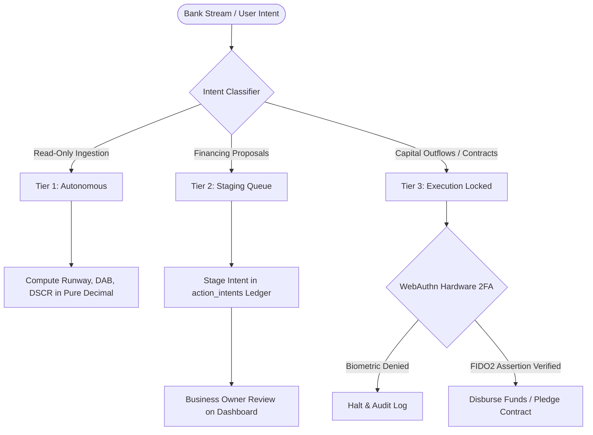

# SME Finance Copilot

> **Autonomous AI CFO & Financial Participant for Small & Medium Enterprises**  
> *FinTechathon 2026 Topic E: AI as a Financial Participant | Tsinghua University PBCSF & WeBank*

[](https://github.com/SamJU25/F-SME-Finance-Copilot/actions/workflows/ci.yml)
[](tests/)
[](https://www.python.org/)
[](https://fastapi.tiangolo.com/)
[](https://nextjs.org/)
[](docker-compose.yml)
[](contracts/)
[](LICENSE)

**Audited Technical Baseline (2026-10-19)**: **779 automated tests passing** across multi-format statement ingestion (CSV and PDF), 25+ deterministic financial engines in pure Python `decimal.Decimal`, dynamic semantic intent routing (FastEmbed ONNX), on-device local SLM inference (fine-tuned Qwen 3B LoRA), Universal Cloud LLM Bridge with live dynamic model discovery, Three-Tier Security Gate with hardware WebAuthn passkeys, and hardened rootless Docker Compose orchestration.

---

## Documentation Hub

Read [`AGENTS.md`](AGENTS.md) for instruction precedence and verified baseline status, [`docs/system.md`](docs/system.md) for concrete mathematical and technical specifications, and [`docs/architecture.md`](docs/architecture.md) for system topology.

| Document | Purpose & Scope |
|---|---|
| 📘 [System Design Specification](docs/system.md) | Concrete implementation mechanics, mathematical formulas, JSON schemas & smart contracts |
| 🏛️ [Architectural Plan & Roadmap](docs/architecture.md) | 6-layer topology, local SLM inference, dynamic vector routing & multi-agent suites |
| 🛡️ [Security Architecture](docs/security.md) | 5 Invariants, threat modeling, Three-Tier Gate, WebAuthn passkeys & decadal defense |
| 📜 [Architecture Decision Records (ADRs)](docs/adr/) | 7 formal Architecture Decision Records (ADR-001 through ADR-007) |
| 📖 [Ubiquitous Domain Glossary](GLOSSARY.md) | Standardized fintech, underwriting, and treasury terminology (CCC, DAB, DSCR, APR) |
| 📄 [Technical Deep Dive Report](docs/SME_Finance_Copilot_Deep_Dive_Report.pdf) | Comprehensive architectural evaluation and benchmark report (PDF) |
| ⚡ [Sprint Workflow](.agent/workflows/sprint-workflow.md) | Contract-first engineering lifecycle and red-green-refactor loop |

---

## 1. Problem Statement: The 75-Day Working Capital Gap

Small and Medium Enterprises (SMEs) represent over 90% of global businesses and 50% of employment. However, **82% of SME bankruptcies stem from cash flow timing mismatches**, rather than a lack of underlying profitability.

Traditional banks require 4 to 8 weeks to underwrite working capital loans and reject up to 80% of applicants due to lack of physical real estate collateral.

```
       [Raw Materials Purchased]         [Finished Goods Sold]             [Cash Collected]
  Day 0 -------------------------- Day 45 ----------------------- Day 105 -----------------
        |                                |                        |
        +-- Supplier Paid: Day 30        |                        |
            (-$30,000 cash out)          |                        |
                                         +-- Invoiced: Day 45     |
                                             ($100,000 Net 60)    |
                                                                  +-- Customer Pays: Day 105
                                                                      (+$100,000 cash in)

  ==> THE 75-DAY CASH GAP: Cash Conversion Cycle (CCC) = DIO (45) + DSO (60) - DPO (30) = 75 Days
```

**SME Finance Copilot** acts as a 24/7 autonomous financial participant. It monitors real-time transactional ledger streams, computes deterministic financial ratios, forecasts cash crunches before payroll bounces, matches businesses with pre-qualified working capital facilities, and registers B2B invoice pledges on consortium blockchains to eliminate invoice double-financing.

---

## 2. Core Subsystems

```
┌─────────────────────────────────────────────────────────────────────────────────────────┐
│                                SME FINANCE COPILOT                                      │
├────────────────────────────┬────────────────────────────┬───────────────────────────────┤
│    1. CFO Health Core      │  2. Predictive Forecast    │    3. Digital Underwriting    │
│  • Pure Decimal runway     │  • Pure Decimal simulation │  • Transaction stream metrics │
│  • Daily Average Balance   │  • 30/60/90-day horizons   │  • Multi-facility ranking     │
│  • DSCR, FCCR & Burn rate  │  • Shortfall pinpointing   │  • Predatory APR flag (>36%)  │
├────────────────────────────┼────────────────────────────┼───────────────────────────────┤
│   4. Universal AI Bridge   │   5. Three-Tier Gate       │   6. Consortium Blockchain    │
│  • Local Qwen 3B LoRA      │  • Tier 1: Read-only auto  │  • FISCO BCOS smart contract  │
│  • 7 Cloud LLM Providers   │  • Tier 2: Proposal staging│  • Canonical SHA-256 hashing  │
│  • Dynamic model discovery │  • Tier 3: WebAuthn 2FA    │  • Double-pledge prevention   │
└────────────────────────────┴────────────────────────────┴───────────────────────────────┘
```

### 2.1 Multi-Format Statement Ingestion Engine (`services/ingestion/`)
- Unified parser (`statement_parser.py`) supporting both UTF-8 CSV statements and multi-page vector/raster PDF bank statements (`pdf_parser.py`, `csv_parser.py`).
- Line-item transaction extraction with opening and closing balance mathematical tie-out:
  $$\text{Opening Balance} + \sum \text{Credits} - \sum \text{Debits} == \text{Closing Balance}$$
- Deterministic row-level error provenance tracking: `INVALID_ROW_SHAPE`, `INVALID_DATE`, `INVALID_AMOUNT`, `INVALID_CURRENCY`, `DUPLICATE_TRANSACTION_ID`, `OUT_OF_ORDER_DATE`.
- Multi-account contra-transfer elimination to prevent duplicate internal cash flow counting across accounts.

### 2.2 Deterministic FinTech Engine (25+ Core Routines in `services/calculations/`)
All monetary calculations execute in pure Python `decimal.Decimal` with `ROUND_HALF_UP` rounding. Zero mathematical calculations are performed by LLMs:
1. **Daily Average Balance (DAB)**: Rolling 30, 60, and 90-day calendar carry-forward across missing weekends and bank holidays (`calculate_dab_from_transactions`).
2. **Gross Cash Flow Decomposition**: Gross operating credits, gross operating debits, net period change, and exact cash runway days (`calculate_cash_analysis`).
3. **Predictive Cash Crunch & Overdraft Pinpointing**: Daily closing balance forward simulation pinpointing projected deficit date and shortfall cents (`predictive_cash.py`).
4. **Weekly Revenue Inflow Volatility Index (CV)**: 7-day interval mean, standard deviation, and coefficient of variation ($CV = \sigma / \mu$) mapped to risk tiers (LOW, MEDIUM, HIGH, CRITICAL).
5. **Working Capital Cash Conversion Cycle (CCC)**: Days Sales Outstanding (DSO), Days Inventory Outstanding (DIO), Days Payable Outstanding (DPO), and total CCC:
   $$\text{CCC} = \text{DSO} + \text{DIO} - \text{DPO}$$
6. **Debt Affordability Models**: Debt Service Coverage Ratio (DSCR) and Fixed-Charge Coverage Ratio (FCCR) (`credit.py`).
7. **Altman Z'-Score for Private Firms**: Bankruptcy hazard classification for non-public enterprises (`credit.py`).
8. **DuPont ROE 3-Stage Decomposition**: Net profit margin $\times$ asset turnover $\times$ equity multiplier (`profitability.py`).
9. **ROIC & Economic Value Added (EVA)**: NOPAT over invested capital and cost-of-capital excess return (`profitability.py`).
10. **Discounted Cash Flow (DCF) & WACC Valuation**: FCFF projections with perpetuity growth terminal value (`valuation.py`).
11. **SaaS Unit Economics**: ARR, CAC Payback, LTV/CAC ratio, Magic Number, and Net Revenue Retention (`unit_economics.py`).
12. **Truth-in-Lending APR & Trade Credit APR**: Factor rate to APR conversion, flagging loans $>36.0\%$ APR as predatory (`credit.py`).
13. **Currency Conversion & Multi-Currency Registry**: ISO 4217 currency registry covering 160+ currencies (`currency.py`).
14. **Continuous Liquidity Scoring (0–100)**: Multi-factor weighted score with gray-zone triage for Prime vs. Conditional facilities (`liquidity_matcher.py`).

### 2.3 Universal Dynamic AI Bridge & Local SLM (`services/agent/`)
- **Dual Inference Engine**:
  - **Local SLM Engine**: On-device inference via fine-tuned `Qwen/Qwen3-4B-Instruct-2507` LoRA adapter (`models/sme-finance-lora`) on PyTorch CUDA with automatic fallback.
  - **Universal Cloud LLM Bridge** (`llm_bridge.py`): Native support for Google Gemini 2.0 Flash, Anthropic Claude 3.5 Sonnet, OpenAI GPT-4o, DeepSeek, Groq, Local Ollama, and Custom OpenAI-compatible endpoints.
- **Dynamic Live Model Discovery**: `POST /api/v1/agent/fetch-models` queries upstream endpoints dynamically to retrieve real-time model catalogs.
- **Dynamic Connection Verification**: `POST /api/v1/agent/test-connection` verifies provider credentials and endpoint reachability with detailed latency metrics.
- **Dynamic Semantic Vector Routing**: FastEmbed ONNX embedding pipeline (`BAAI/bge-small-en-v1.5`) with cosine similarity triage—zero regex or hardcoded keyword intercepts.
- **Anti-Slop Post-Processing**: Dynamic neural CFO responses grounded in deterministic calculation context without template repetitions.
- **Pre-Flight Privacy Shield**: PII scrubbing redacting IBANs, bank routing numbers, and contact details before data enters LLM context.

### 2.4 Three-Tier Security Gate & WebAuthn Passkeys (`services/security/`)
Every autonomous action is gated by the Three-Tier Security Matrix:



- **Tier 1 (Observation — Autonomous)**: Read-only data ingestion and calculations.
- **Tier 2 (Staging — Queue Only)**: Loan applications and credit proposals placed into an immutable staging ledger (`action_intents`). No capital movement.
- **Tier 3 (Execution — Strict HITL 2FA)**: Irreversible financial transactions (drawing credit lines, wire disbursements, contract signing) require physical Human-in-the-Loop WebAuthn hardware biometric passkeys (Touch ID, Face ID, YubiKey) verified cryptographically via `py_webauthn`.

### 2.5 Consortium Blockchain Double-Pledge Defense (`contracts/`)
- Generates canonical `SHA-256` content hashes from invoice metadata:
  $$\text{InvoiceHash} = \text{SHA-256}(\text{TaxID} \parallel \text{BuyerID} \parallel \text{InvoiceNum} \parallel \text{AmountCents})$$
- Submits verification payloads to `InvoiceRegistry.sol` on FISCO BCOS to eliminate fraudulent invoice double-pledging across lenders.

---

## 3. REST API Specification

All monetary values across JSON API boundaries are serialized as decimal strings (e.g., `"125000.50"`), never floating-point numbers.

| Method | Endpoint | Description | Security Tier | Payload / Format |
|---|---|---|---|---|
| `GET` | `/api/v1/health` | Service health status and uptime probe | Public | JSON status |
| `POST` | `/api/v1/analyze` | Ingests CSV or PDF statement; runs tie-out and runway math | Tier 1 (Read-Only) | Multipart form (`file`) |
| `POST` | `/api/v1/underwrite` | Evaluates transactional metrics against underwriting rules | Tier 1 (Read-Only) | JSON financial metrics |
| `POST` | `/api/v1/actions` | Stages financing proposal into staging queue | Tier 2 (Staging) | JSON action intent |
| `POST` | `/api/v1/actions/{id}/execute` | Executes staged action with WebAuthn passkey assertion | Tier 3 (HITL 2FA) | JSON WebAuthn assertion |
| `POST` | `/api/v1/agent/chat` | AI CFO dialogue with semantic routing & dynamic bridge | Tier 1 (Read-Only) | JSON message + provider |
| `POST` | `/api/v1/agent/test-connection` | Verifies LLM provider credentials and endpoint connectivity | Tier 1 (Read-Only) | JSON credentials |
| `POST` | `/api/v1/agent/fetch-models` | Dynamically discovers available models from target provider | Tier 1 (Read-Only) | JSON credentials |

---

## 4. Quickstart Guide

### Option A: One-Command Docker Setup (Recommended)

Requires [Docker Desktop](https://www.docker.com/products/docker-desktop/) or Docker Engine.

```bash
# Clone the repository
git clone https://github.com/SamJU25/F-SME-Finance-Copilot.git
cd F-SME-Finance-Copilot

# Build and start all services in rootless containers
docker compose up --build -d
```

- **Frontend Dashboard**: Open <http://localhost:3000>
- **FastAPI Backend**: Open <http://localhost:8000/api/v1/health>
- **Interactive OpenAPI Docs**: Open <http://localhost:8000/docs>

```bash
# View live container logs
docker compose logs -f

# Stop containers
docker compose down
```

---

### Option B: Local Developer Setup

#### Prerequisites
- **Python 3.11+**
- **Node.js 18+** and `npm`

#### 1. Backend Setup
```bash
# Create and activate Python virtual environment
python -m venv .venv

# Windows PowerShell:
.\.venv\Scripts\Activate.ps1
# macOS/Linux:
source .venv/bin/activate

# Install dependencies
python -m pip install --upgrade pip
python -m pip install -r requirements.txt

# Start FastAPI backend
python -m uvicorn api.main:app --host 127.0.0.1 --port 8000 --reload
```

#### 2. Frontend Setup
```bash
# Install pinned dependencies
npm ci

# Start Next.js development server
npm run dev -- --hostname 127.0.0.1 --port 3000
```

Open <http://127.0.0.1:3000> in your browser. Download the sample bank statement [`data/samples/synthetic-statement.csv`](data/samples/synthetic-statement.csv) and upload it to analyze cash flows, view predictive cash crunches, and test AI CFO interactions.

---

## 5. Verification & Test Suite

Run the full verification suite from the repository root with the virtual environment active:

```bash
# Run backend test suite (779 tests)
python -m pytest -q

# Run frontend type checking
npm run type-check

# Run production frontend build
npm run build
```

### Verified Test Breakdown
```
tests/unit/            691 passed   (Ingestion, Pure Decimal Math, Underwriting, Decision Tables)
tests/integration/      48 passed   (FastAPI Endpoints, LLM Bridge, Model Discovery, WebAuthn)
tests/security/         26 passed   (Three-Tier Gate Invariants, PII Sanitization, Tampering)
tests/e2e/              14 passed   (Full Statement Ingestion to WebAuthn Execution Flows)
============================= 779 passed in 24.30s =============================
```

---

## 6. Hackathon Evaluation Rubric Alignment

| Evaluation Criteria | Weight | Implementation Evidence |
|---|---|---|
| **Task Completion** | **40%** | Full transactional bank statement ingestion (CSV and PDF), 25+ pure Decimal financial calculation routines, 30/60/90-day predictive cash deficit forecasting, and automated credit facility matching. |
| **Defensive Security & Governance** | **30%** | Three-Tier Security Gate isolating autonomous analysis from capital execution, cryptographically verified WebAuthn hardware biometric passkeys (`py_webauthn`), pre-flight Presidio PII redaction, and strict Pydantic v2 schemas. |
| **Technical Innovation** | **30%** | Transaction-stream digital underwriting (WeBank model), on-device local SLM inference (Qwen 3B LoRA), dynamic live model discovery across 7 LLM providers, FastEmbed semantic vector intent routing, and consortium blockchain invoice double-pledging defense (FISCO BCOS). |

---

## 7. License & Notice

This project was built for **FinTechathon 2026 Topic E: AI as a Financial Participant**, organized by Tsinghua University PBCSF and WeBank.

Distributed under the MIT License. See [`LICENSE`](LICENSE) for details.
