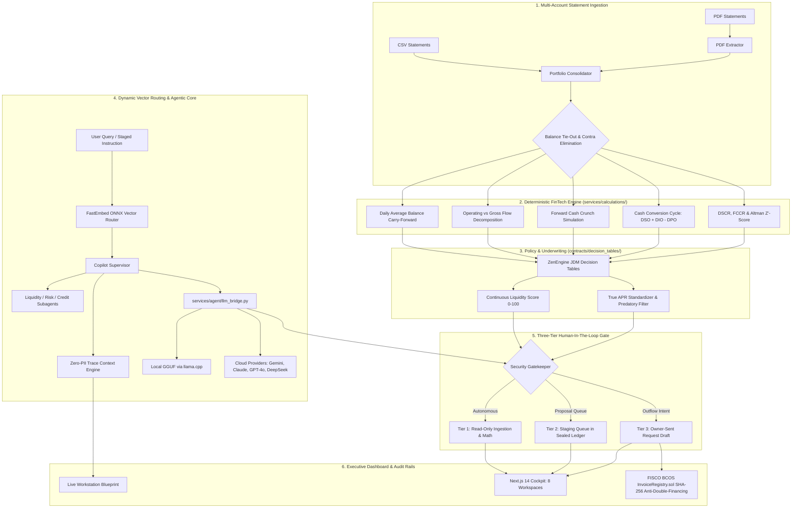

# CashPilot

> **Autonomous AI Financial Participant & Treasury Copilot for Small & Medium Enterprises**  
> *FinTechathon 2026 Topic E: AI as a Financial Participant | Tsinghua University PBCSF & WeBank*

[](https://github.com/SamJU25/CashPilot/actions/workflows/ci.yml)
[](tests/)
[](https://www.python.org/)
[](https://fastapi.tiangolo.com/)
[](https://nextjs.org/)
[](docker-compose.yml)
[](contracts/)
[](LICENSE)

**Audited Technical Baseline (2026-10-22)**: **1,022 automated tests passing (1 POSIX-only skip)** across multi-format statement ingestion (CSV and PDF), 25+ deterministic financial calculation routines in pure Python `decimal.Decimal`, dynamic semantic intent routing (FastEmbed ONNX), on-device local GGUF inference (Qwen 2.5 / Llama 3.2 text models via llama.cpp), Universal Cloud LLM Bridge with live dynamic model discovery across 7 providers, Three-Tier Security Gate with owner-sent Tier 3 requests (no execution route), zero-PII execution tracing, and a Next.js 14 executive cockpit with 8 functional workspaces.

---

## 1. Why CashPilot Exists: The Working Capital Trap

Over 82% of small business failures are not caused by lack of sales or negative margins—they happen because of **cash flow timing mismatches**. A company can close $100,000 in profitable contracts today, yet go bankrupt next month when payroll bounces because enterprise clients take 60 days to pay while suppliers demand payment in 30 days.

```
       [Raw Materials Purchased]         [Finished Goods Delivered]         [Customer Cash Collected]
  Day 0 -------------------------- Day 45 ------------------------- Day 105 -----------------
        |                                 |                          |
        +-- Supplier Paid: Day 30         |                          |
            (-$30,000 cash out)           |                          |
                                          +-- Invoiced: Day 45       |
                                              ($100,000 Net 60)      |
                                                                     +-- Cash Received: Day 105
                                                                         (+$100,000 cash in)

  ==> THE 75-DAY CASH CHASM: Cash Conversion Cycle (CCC) = DIO (45) + DSO (60) - DPO (30) = 75 Days
```

Traditional commercial banks take 4 to 8 weeks to underwrite working capital loans and reject up to 80% of applicants due to a lack of physical real estate collateral. Accounting software only reports what already happened in the past.

**CashPilot bridges this gap as an active 24/7 financial participant**:
1. **Reads Reality in Seconds**: Ingests messy, multi-account bank statements (CSV/PDF) and ties out running balances down to the exact cent.
2. **Forecasts the Deficit**: Simulates forward daily balances across 30/60/90-day horizons to pinpoint the exact date payroll will bounce before it happens.
3. **Underwrites Without Collateral**: Implements WeBank-style digital transaction underwriting using Daily Average Balance (DAB) and revenue volatility indices.
4. **Protects the Owner**: Standardizes predatory loan factor rates into true Annual Percentage Rate (APR) and isolates money movement behind an owner-sent Three-Tier security gate.

---

## 2. Visual Architecture



---

## 3. Core Capabilities & Workspaces

CashPilot provides **8 functional workspaces** compiled via Next.js 14 App Router, built with Emil Kowalski spring motion transitions and strict monospace tabular numbers:

### 1. Overview Dashboard (`/`)
- **Real-Time Cash Runway**: Circular dial gauge and 90-day cash progression curve comparing baseline burn against scenario overlays.
- **Dynamic Cash Bridge**: Decomposes opening balance, operating inflows, operating outflows, and closing treasury totals.
- **Owner Entries Ledger**: An immutable audit ledger for manual cash adjustments, featuring single-click offsetting reversal entries so backend statements and audit logs never fall out of sync.

### 2. Live Workstation & Cognitive Blueprint (`/workstation`)
- **Interactive Execution Blueprint**: Renders the complete 7-stage cognitive pipeline (`Ask -> Guard -> Route -> Agent -> Work -> Knowledge -> Answer`).
- **Deep Execution Tracing**: Click on any node to view real millisecond timings, matched ZenEngine decision table rules, confidence thresholds, tool execution statuses, and knowledge card retrieval scores.
- **Zero-PII Contextvar Engine**: Captures execution order and timings via `services/agent/trace.py` without storing customer statement rows or message text.

### 3. Early Warning Sentinel (`/sentinel`)
- **Forward Shortfall Pinpointing**: Daily closing balance simulation identifying the exact day liquidity falls below zero and computing the exact bridge amount needed.
- **Customizable Threshold Sliders**: Adjust early warning windows from 15 to 90 days with instant recalculation of deficit risks.

### 4. AI Treasury Assistant (`/assistant`)
- **Anti-Slop Grounded Reasoning**: Dynamic CFO responses grounded exclusively in deterministic calculation context without hallucinations or fabricated bullet points.
- **Live Financial Telemetry**: Side-panel telemetry showing Cash Balance, Cash Runway, Daily Burn, and Period Change styled in cockpit typography with live pulsating alert indicators.
- **Privacy Shield**: Pre-flight regex redacting IBANs, routing numbers, and contact details before data reaches external LLMs.

### 5. Funding Marketplace & Digital Underwriting (`/funding`)
- **WeBank-Style Continuous Liquidity Score (0–100)**: Evaluates revenue volatility, transaction counts, and Daily Average Balance (DAB) rather than relying on stale annual balance sheets.
- **Truth-in-Lending APR Conversion**: Converts misleading merchant cash advance factor rates (e.g., 1.15x) into annualized APR.
- **Predatory Loan Quarantine**: Any facility with APR > 36% is automatically stripped from the primary options grid and segregated into the "Avoid this offer" warning banner.

### 6. Human-In-The-Loop Approvals (`/approvals`)
- **Immutable Staging Queue**: View proposals drafted by the AI agent (credit applications, factoring agreements, vendor notifications).
- **Zero Auto-Execution Invariant**: Tier 3 financial transactions are never executed by the system. The owner reviews the pre-filled request (`POST /api/v1/actions/{id}/prepare`) and transmits it themselves.

### 7. Statements & Portfolio Consolidator (`/statements`)
- **Multi-Account Auto-Clustering**: Automatically connects sequential monthly statements using balance tie-outs ($Opening_B == Closing_A \pm \$0.01$).
- **Contra-Transfer Elimination**: Detects internal wire sweeps between accounts (e.g., transferring $10,000 from Chase Operating to SVB Payroll) and excludes them from revenue and burn calculations.
- **Row-Level Error Provenance**: Flags corrupt rows with exact failure codes (`INVALID_DATE`, `INVALID_AMOUNT`, `INVALID_ROW_SHAPE`, `DUPLICATE_TRANSACTION_ID`).

### 8. B2B Receivables & Consortium Blockchain (`/receivables`)
- **Aging Invoices Matrix**: Classifies unpaid customer invoices into Current, 1–30, 31–60, 61–90, and 90+ day aging buckets.
- **Anti-Double-Financing Defense**: Generates deterministic SHA-256 hashes of B2B invoices and checks them against the consortium ledger (`InvoiceRegistry.sol` on FISCO BCOS) to prevent multiple lenders from factoring the same asset.

---

## 4. Pure Deterministic FinTech Engine

All monetary and treasury calculations reside in `services/calculations/` and execute in pure Python `decimal.Decimal` with `ROUND_HALF_UP` rounding. LLMs are strictly forbidden from performing mathematical approximations:

| Financial Routine | Module | Formula / Mechanics |
|---|---|---|
| **Daily Average Balance (DAB)** | `services/calculations/dab.py` | Calendar carry-forward across non-banking days: $\text{DAB} = \frac{1}{N} \sum_{t=1}^N \text{Balance}_t$ |
| **Cash Conversion Cycle (CCC)** | `services/calculations/working_capital.py` | $\text{CCC} = \text{DSO} + \text{DIO} - \text{DPO}$ |
| **Revenue Inflow Volatility (CV)** | `services/calculations/predictive_cash.py` | $CV = \frac{\sigma_{\text{weekly}}}{\mu_{\text{weekly}}}$ mapped to LOW / MEDIUM / HIGH / CRITICAL |
| **Debt Coverage (DSCR & FCCR)** | `services/calculations/credit.py` | $\text{DSCR} = \frac{\text{Net Operating Income}}{\text{Total Debt Service}}$ |
| **Private Firm Altman Z'-Score** | `services/calculations/credit.py` | $Z' = 0.717X_1 + 0.847X_2 + 3.107X_3 + 0.420X_4 + 0.998X_5$ |
| **DuPont ROE 3-Stage** | `services/calculations/profitability.py` | $\text{ROE} = \text{Profit Margin} \times \text{Asset Turnover} \times \text{Financial Leverage}$ |
| **Truth-in-Lending APR** | `services/calculations/credit.py` | Converts factor rates to true APR; flags loans $> 36\%$ APR |
| **SaaS Unit Economics** | `services/calculations/unit_economics.py` | LTV/CAC ratio, CAC Payback months, Magic Number, and Net Retention |

---

## 5. Quickstart Setup Guide

### Option 1: Fast Docker Launch (Recommended)

Requires [Docker Desktop](https://www.docker.com/products/docker-desktop/) or Docker Engine with Docker Compose.

```bash
# 1. Clone the repository
git clone https://github.com/SamJU25/CashPilot.git
cd CashPilot

# 2. Copy the environment template
cp .env.example .env

# 3. Launch isolated multi-stage containers
docker compose up --build -d
```

- **Frontend Cockpit**: Open <http://localhost:3000>
- **FastAPI Backend Health**: Open <http://localhost:8000/api/v1/health>
- **Interactive OpenAPI Documentation**: Open <http://localhost:8000/docs>

```bash
# View live container logs
docker compose logs -f

# Stop containers
docker compose down
```

---

### Option 2: Local Developer Setup

#### 1. Backend Service (FastAPI & Deterministic Engine)
```bash
# Create and activate virtual environment
python -m venv .venv

# On Windows PowerShell:
.\.venv\Scripts\Activate.ps1
# On macOS / Linux:
source .venv/bin/activate

# Install backend dependencies
python -m pip install --upgrade pip
python -m pip install -r requirements.txt

# Start FastAPI backend service
python -m uvicorn api.main:app --host 127.0.0.1 --port 8000 --reload
```

#### 2. Frontend Cockpit (Next.js 14)
```bash
# Open a new terminal in the project root
npm ci

# Launch production build (sub-10ms route switching)
npm run build
npm start -- -p 3000

# Or launch hot-reloading dev server
npm run dev
```

#### 3. AI Engine Configuration (Choose Cloud, Local, or Deterministic)

CashPilot adapts seamlessly to your environment:
- **Cloud AI (Zero Local Footprint)**: Add your provider API key in `.env` (`GEMINI_API_KEY`, `ANTHROPIC_API_KEY`, `OPENAI_API_KEY`, `DEEPSEEK_API_KEY`, or `GROQ_API_KEY`).
- **Local SLM (100% Offline via GGUF)**: Run quantized models locally on your GPU or CPU without third-party APIs:
  ```bash
  python scripts/download_model.py --model qwen2.5-3b-instruct
  ```
- **Pure Deterministic (Zero AI Config)**: If no LLM is configured, CashPilot runs 100% of its financial ratios, runway projections, and loan matching via pure Python `decimal.Decimal`.

---

## 6. The Three-Tier Human-In-The-Loop Security Gate

Every action endpoint requires a verified tenant token issued by `POST /api/v1/auth/token`. CashPilot enforces a strict physical separation between analysis and execution:

```
┌────────────────────────────────────────────────────────────────────────┐
│ TIER 1: AUTONOMOUS OBSERVATION (Read-Only)                             │
│ CSV/PDF statement ingestion, 25+ Decimal ratios, runway forecasting.   │
└───────────────────────────────────┬────────────────────────────────────┘
                                    │
                                    ▼
┌────────────────────────────────────────────────────────────────────────┐
│ TIER 2: STAGING QUEUE (Queue Only — Zero Capital Movement)             │
│ Financing proposals and reminders drafted in a Fernet-sealed ledger.   │
└───────────────────────────────────┬────────────────────────────────────┘
                                    │
                                    ▼
┌────────────────────────────────────────────────────────────────────────┐
│ TIER 3: OWNER-SENT REQUEST (Never Executed by System)                  │
│ CashPilot prepares the request draft at POST /api/v1/actions/{id}/     │
│ prepare. The business owner transmits it themselves. Zero payment      │
│ credentials stored in the system = Zero prompt injection drain risk.   │
└────────────────────────────────────────────────────────────────────────┘
```

---

## 7. Automated Test Suite & Verification

Run the full deterministic verification suite from the repository root:

```bash
# 1. Run full backend pytest suite (1,022 passed, 1 POSIX skip)
pytest -q

# 2. Run frontend TypeScript verification
npm run type-check

# 3. Compile production Next.js static routes
npm run build
```

### Verified Test Breakdown (Audited 2026-10-22)
```
tests/unit/            861 passed            (Ingestion, Decimal Math, Underwriting, Tracing, Session Store)
tests/integration/     105 passed            (FastAPI Endpoints, Multi-Account Sync, Action Ledger, Model Discovery)
tests/security/         54 passed, 1 skipped (Three-Tier Invariants, PII Scrubbing, Fernet Sealing, Hardening)
tests/e2e/               2 passed            (Full Multi-Statement Ingestion to Prepared-Action Journey)
======================= 1022 passed, 1 skipped in 33.09s =======================
```

*(Note: The single skipped test is a POSIX-only file mode assertion `0700/0600` on Windows filesystems; it is verified in Ubuntu 24.04 CI containers).*

---

## 8. Documentation Index

| Specification | Focus & Technical Scope |
|---|---|
| 📘 [System Design Specification](docs/system.md) | Mathematical formulas, JSON schemas, and smart contract specifications |
| 🏛️ [Architectural Plan](docs/architecture.md) | 6-layer topology, local SLM inference, dynamic vector routing, and multi-agent suites |
| 🛡️ [Security Architecture](docs/security.md) | Threat modeling, Three-Tier Gate invariants, Fernet encryption, and tenant isolation |
| 📖 [Domain Glossary](docs/GLOSSARY.md) | Standardized fintech definitions (CCC, DAB, DSCR, True APR, NSF) |
| ⚡ [Sprint Workflow](.agent/workflows/sprint-workflow.md) | Contract-first development protocol and verification gates |

---

## 9. License & Academic Attribution

Developed for **FinTechathon 2026 Topic E: AI as a Financial Participant**, organized by Tsinghua University PBCSF and WeBank.

Distributed under the MIT License. See [`LICENSE`](LICENSE) for complete terms.
