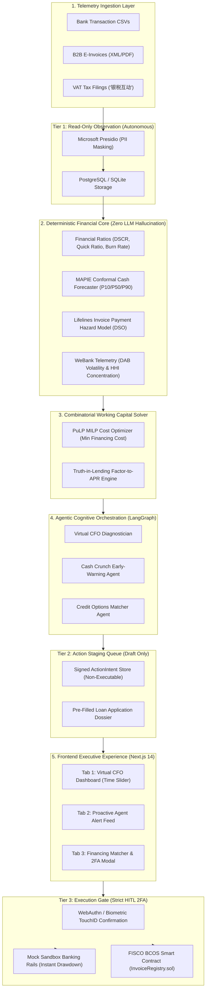

# SME Finance Copilot: Master Architectural Plan & System Specification
**FinTechathon 2026 Track E | Host: Tsinghua University PBCSF & WeBank**
*Architectural Blueprint, Technology Selection Rationale, and Execution Plan*

---

## 1. Executive Vision: The "Autonomous Financial Participant"

Unlike conversational chatbots that passively wait for questions and hallucinate math, the **SME Finance Copilot** is an **autonomous financial participant**:
1. **Continuously Observes**: Programmatically ingests bank transactions, B2B invoices, and VAT tax records.
2. **Deterministically Predicts**: Runs calibrated econometric models to forecast cash runway and identify deficit troughs 10–15 days before checks bounce.
3. **Mathematically Solves**: Uses Mixed-Integer Linear Programming (MILP) to find the provably cheapest financing combination (credit line, invoice factoring, payable stretching) rather than guessing a loan.
4. **Safely Governs**: Enforces a strict 3-Tier Security Gate where all financial actions require human biometric 2FA.
5. **Trustlessly Anchors**: Employs consortium blockchain (FISCO BCOS) to eliminate invoice double-financing across lending institutions.

---

## 2. Selected Technology Stack & Architectural Rationale

To guarantee production reliability for real small business owners, every technology has been curated with explicit engineering justification:

| Architectural Layer | Selected Technology | Deep Technical Rationale (Why We Need This) |
|---|---|---|
| **1. Calculation Sandbox** | **Python `decimal.Decimal`** | Floating-point numbers (`float`) suffer from binary representation errors (`0.1 + 0.2 != 0.3`). In compounding interest, tax deductions, and loan amortization, float errors accumulate and cause audit failures. `Decimal` provides exact arbitrary-precision arithmetic. |
| **2. Forecasting Engine** | **MAPIE Conformal Prediction + Lifelines Survival Analysis** | Point forecasts (ARIMA/linear regression) are uncalibrated and overconfident. MAPIE (ICML EnbPI) produces **mathematically guaranteed 90% prediction intervals** without assuming normal distribution. Lifelines models invoice payment delay distributions with right-censored data, accurately forecasting Days Sales Outstanding (DSO). |
| **3. Liquidity Optimizer** | **PuLP / COIN-OR CBC (MILP Solver)** | When an overdraft is forecasted, naive tools guess a loan. PuLP formulates a Mixed-Integer Linear Program to **minimize the total cost of capital** subject to maintaining a mandatory cash buffer, outputting an exact, multi-instrument bridge plan. |
| **4. Agentic Orchestrator** | **LangGraph State Graph** | LLM chains are brittle and prone to infinite loops. LangGraph provides a cyclic directed state machine with explicit typed state schemas, deterministic checkpoints, and human-in-the-loop interruption boundaries. |
| **5. Data Validation & Guardrails** | **Pydantic v2 + DSPy Assertions** | Pydantic v2 (Rust core) enforces strict runtime schema validation. DSPy computational assertions (`dspy.Assert`) programmatically force the LLM to self-refine if extracted financial statements violate double-entry accounting identities. |
| **6. Security & Privacy Gate** | **Microsoft Presidio + WebAuthn FIDO2** | Presidio anonymizes all PII (names, IBANs, tax IDs) at Tier 1 before LLM ingestion. WebAuthn enforces hardware-backed biometric verification (TouchID/FaceID) at Tier 3 before any capital movement or contract signing can execute. |
| **7. Consortium Blockchain** | **FISCO BCOS (`InvoiceRegistry.sol`)** | Addresses the primary scoring bonus (+5 pts) and WeBank's core domain. Solves the supply-chain double-financing crisis: multi-institutional state machine (`UNREGISTERED` $\to$ `VERIFIED` $\to$ `PLEDGED` $\to$ `SETTLED`) ensuring an invoice cannot be financed twice. |
| **8. Executive Frontend** | **Next.js 14 App Router + Recharts + Tailwind** | Monospace tabular numerals (`font-variant-numeric: tabular-nums`) prevent UI layout jitter. An interactive 90-day timeline slider lets the business owner scrub time and visualize the cash deficit trough in real time. |

---

## 3. End-to-End System Architecture



---

## 4. Domain Data Models & Schema Design

### 4.1 Transaction & Account Schema
```python
# schema/transactions.py
from datetime import date
from decimal import Decimal
from enum import Enum
from pydantic import BaseModel, Field


class TransactionCategory(str, Enum):
  REVENUE = "REVENUE"
  PAYROLL = "PAYROLL"
  RENT = "RENT"
  SUPPLIER_COGS = "SUPPLIER_COGS"
  TAX = "TAX"
  FINANCING = "FINANCING"
  OTHER_EXPENSE = "OTHER_EXPENSE"


class BankTransaction(BaseModel):
  id: str
  account_id: str
  transaction_date: date
  amount: Decimal = Field(..., description="Positive = Inflow, Negative = Outflow")
  description: str
  category: TransactionCategory
  counterparty: str
  running_balance: Decimal
```

### 4.2 Staged Action Intent Schema (Tier 2 Staging)
```python
# schema/security.py
from datetime import datetime
from decimal import Decimal
from enum import Enum
from typing import Any, Dict
from pydantic import BaseModel, Field


class ActionTier(str, Enum):
  TIER_1_OBSERVATION = "TIER_1_OBSERVATION"
  TIER_2_STAGING = "TIER_2_STAGING"
  TIER_3_EXECUTION = "TIER_3_EXECUTION"


class ActionIntent(BaseModel):
  intent_id: str
  created_at: datetime
  tier: ActionTier = ActionTier.TIER_2_STAGING
  action_type: str  # e.g., "DRAW_CREDIT_LINE", "FACTOR_INVOICE"
  description: str
  amount: Decimal
  counterparty_institution: str
  effective_apr: Decimal
  parameters: Dict[str, Any]
  idempotency_key: str
  is_executed: bool = False
  executed_at: datetime | None = None
  authorization_token: str | None = None
```

---

## 5. Master Implementation Roadmap (6 Sprints)

### Sprint 1: Deterministic FinTech Engine (`services/calculations/`)
- **Deliverables**:
  - `financial_ratios.py`: DSCR, Quick Ratio, Monthly Burn, Cash Runway.
  - `apr_converter.py`: Truth-in-lending factor-rate-to-APR converter with $>36\%$ predatory flag.
  - `we_bank_metrics.py`: Daily Average Balance (DAB), Coefficient of Variation ($CV$), NSF count, HHI concentration.
  - `tests/test_calculations.py`: Pytest suite with exact `decimal.Decimal` assertions for the Alex's Apparel Co. benchmark dataset.
- **Verification Gate**: `pytest tests/test_calculations.py` passing 100%.

### Sprint 2: Econometric Forecaster & Optimization Solver (`services/forecasting/` & `services/optimizer/`)
- **Deliverables**:
  - `conformal_forecaster.py`: MAPIE EnbPI time-series predictor generating P10/P50/P90 cash bands across 30/60/90 days.
  - `working_capital_solver.py`: PuLP MILP optimization model that minimizes capital cost across revolving credit, invoice factoring, and payable deferrals.
  - `tests/test_solver.py`: Verifies that the solver outputs the mathematically cheapest solution when tested against simulated payroll deficits.
- **Verification Gate**: `pytest tests/test_solver.py` passing with optimal solution identified.

### Sprint 3: Three-Tier Security Gate & Action Intent Engine (`services/security/`)
- **Deliverables**:
  - `pii_sanitizer.py`: Microsoft Presidio wrapper redacting sensitive customer and financial PII.
  - `permission_gate.py`: Enforces Tier 1 (read-only), Tier 2 (staged intent queue), and Tier 3 (blocked until 2FA).
  - `dspy_assertions.py`: Programmatic verification enforcing accounting balance equations on all outputs.
  - `tests/test_security_gate.py`: Verifies that Tier 3 calls reject unauthorized execution and require valid 2FA tokens.
- **Verification Gate**: `pytest tests/test_security_gate.py` passing 100%.

### Sprint 4: Multi-Agent Orchestration Engine (`services/agents/`)
- **Deliverables**:
  - `state.py`: TypedDict state definition for the financial copilot graph.
  - `graph.py`: LangGraph state machine: `Ingest` $\to$ `Diagnose` $\to$ `Detect Risk` $\to$ `Optimize & Match` $\to$ `Stage Intent`.
  - `tests/test_agents.py`: End-to-end simulation of the Alex's Apparel Co. 15-day crisis scenario.
- **Verification Gate**: `pytest tests/test_agents.py` verifies proactive alert generation on Day 5 before Day 15 payroll.

### Sprint 5: Consortium Blockchain Contract (`contracts/` & `services/blockchain/`)
- **Deliverables**:
  - `InvoiceRegistry.sol`: Solidity 0.8.20 smart contract implementing deterministic hashing (`keccak256`) and multi-bank FSM (`UNREGISTERED`, `VERIFIED`, `PLEDGED`, `SETTLED`).
  - `blockchain_client.py`: Python client interacting with the FISCO BCOS / EVM testnet node.
  - `tests/test_invoice_registry.py`: Tests that concurrent financing attempts by a second bank are automatically reverted.
- **Verification Gate**: `pytest tests/test_invoice_registry.py` proving double-financing prevention.

### Sprint 6: Executive Generative UI Dashboard (`frontend/`)
- **Deliverables**:
  - Tab 1: Virtual CFO Dashboard with real-time metric cards and an interactive 90-day timeline slider.
  - Tab 2: Proactive Agent Alert Feed displaying autonomous warnings and matched solutions.
  - Tab 3: Financing Matcher & 2FA Modal with side-by-side APR comparisons and WebAuthn confirmation.
- **Verification Gate**: `npm run build` and `npm run lint` clean with zero errors.
